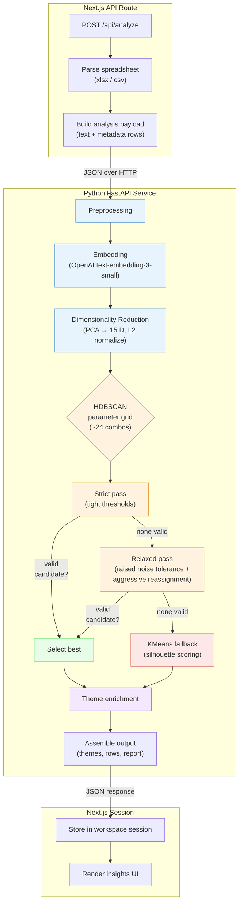
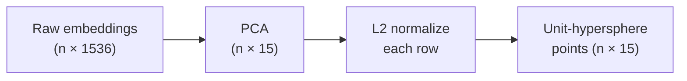
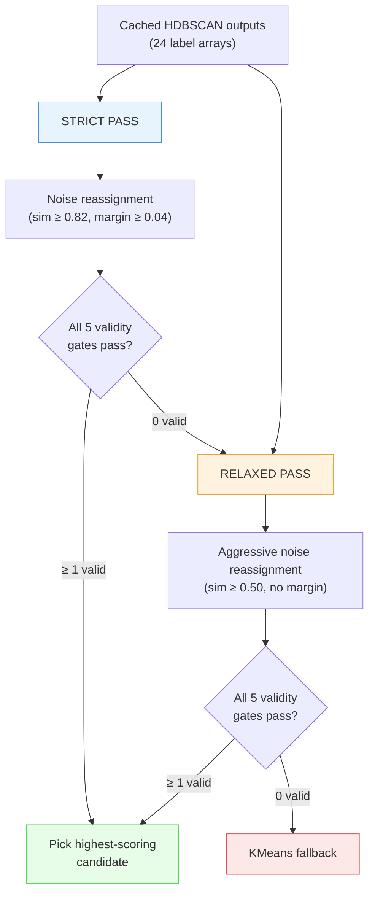

# Topic Modelling Pipeline

This document describes the end-to-end analysis pipeline that turns raw feedback rows into themed, labelled insight packs. The pipeline spans two runtimes — a Next.js API route that owns spreadsheet parsing and session management, and a FastAPI Python service (`api/python_analyze.py`) that owns the semantic analysis.

## TL;DR — HDBSCAN vs KMeans

| | HDBSCAN (primary) | KMeans (fallback) |
|---|---|---|
| **One-liner** | Discovers natural groupings by finding dense pockets of similar feedback. | Splits all feedback into a fixed number of equal-ish buckets. |
| **How it decides groups** | Looks at where feedback is *densely packed* — a cluster appears wherever many comments are close together in meaning. It does **not** need to be told how many groups to find. | You tell it "give me *k* groups" and it places a pin in each group's centre, then assigns every comment to the nearest pin. |
| **Handling outliers** | Comments that sit alone (not close to any dense pocket) are flagged as **noise** and reassigned carefully. This means oddball feedback does not dilute a real theme. | Every single comment is forced into a group — even if it has nothing in common with its neighbours. No outlier concept. |
| **Theme quality** | Themes tend to be more **coherent** (tight, specific topics) because the algorithm only forms a group when there is genuine evidence of a cluster. | Themes can be **broader or blurrier** because the algorithm must fill exactly *k* groups regardless of how the data naturally sits. |
| **When it struggles** | When feedback is very uniform or very sparse, there may be no clear dense pockets — the algorithm cannot find valid groups and hands off to KMeans. | Works on any data shape but sacrifices specificity. |
| **Bottom line** | Preferred when quality and specificity of themes matter. | Reliable safety net that always produces a result. |

> **In plain English:** think of HDBSCAN as an analyst who reads all the feedback, notices which comments naturally clump together, and only names a theme when there is a real pattern. KMeans is more like sorting comments into a pre-set number of folders — fast and guaranteed, but the folders may not perfectly match what the data is actually saying.

ThemeLens always tries HDBSCAN first. If the data does not have clear enough patterns (which can happen with very homogeneous or very noisy input), it automatically falls back to KMeans so you always get results.

---

## Pipeline overview



---

## 1. Request entry (Next.js)

**File:** `src/app/api/analyze/route.ts`

The `POST /api/analyze` route:

1. Reads the uploaded file from form-data (or retrieves a previously uploaded workbook from the in-memory session store).
2. Parses the spreadsheet with the `xlsx` library into a `ParsedWorkbook`.
3. Calls `buildAnalysisPayload()` in `src/lib/analysis-client.ts` to assemble the JSON payload — one object per row with the text column value and any selected metadata columns.
4. Forwards the payload to the Python service via HTTP POST.

**Payload shape:**

```json
{
  "fileName": "feedback-export.xlsx",
  "sheetName": "Sheet1",
  "totalRows": 1415,
  "textColumn": "verbatim_comment",
  "metadataColumns": ["region", "date"],
  "languageHint": "Italian",
  "rows": [
    { "id": "row-1", "rowNumber": 1, "text": "...", "metadata": { "region": "EU" } }
  ]
}
```

---

## 2. Preprocessing

**Function:** `analyze_payload()` — the first loop over `payload.rows`.

Each row passes through three gates:

| Gate | Condition | Outcome |
|------|-----------|---------|
| Empty | `clean_text(text)` is blank | Dropped (`removed_empty_rows`) |
| Tag-like | `is_tag_like(text)` matches code-like patterns (e.g. `TICKET-1234`, `ABC / 001`) | Excluded from clustering, kept in evidence as `excluded_taglike` |
| Clusterable | Passes both gates | Enters the embedding pipeline |

Sentiment is classified per-row at this stage using a keyword-match heuristic (`classify_sentiment`) with multilingual cue lists (English, Italian, Spanish, French). The result is `positive`, `negative`, or `neutral`.

---

## 3. Embedding

**Function:** `build_embeddings()`

Clusterable texts are sent to the OpenAI Embeddings API in batches of 128 rows.

| Setting | Value |
|---------|-------|
| Model | `text-embedding-3-small` |
| Output dimensions | 1 536 per vector |
| Batch size | 128 |

The returned vectors are L2-normalized by the API. The result is an `(n, 1536)` float32 matrix.

---

## 4. Dimensionality reduction

**Function:** `reduce_dimensions()`



Two transformations are applied:

1. **PCA to 15 dimensions.** Fewer dimensions produce a sharper density landscape for HDBSCAN. The target is `min(15, n − 1, features)` so it degrades gracefully for tiny datasets.

2. **L2 normalization.** After PCA, rows are projected onto the unit hypersphere. This makes Euclidean distance in the reduced space proportional to cosine distance in the original embedding space — the natural similarity metric for text embeddings.

---

## 5. Clustering

This is the core of the pipeline. It uses a two-pass HDBSCAN strategy with a KMeans safety net.

### 5.1 Parameter grid

**Function:** `build_hdbscan_parameter_grid()`

A grid of `(min_cluster_size, min_samples)` pairs is generated dynamically from `sqrt(n)`:

- **`min_cluster_size`** candidates: `{0.3√n, 0.4√n, 0.6√n, 0.8√n, √n, 1.25√n, 1.6√n, 2.0√n}`, floored at `max(3, 0.3√n)`.
- **`min_samples`** candidates: `{1, 2, 4}` (pruned where `min_samples > min_cluster_size`).

For 1 000 rows this produces roughly 24 combinations.

### 5.2 HDBSCAN execution

**Function:** `cluster_with_hdbscan()`

Each grid combination is run through `hdbscan.HDBSCAN` with Euclidean metric and the Excess of Mass (EOM) cluster selection method. Raw labels (cluster ID or −1 for noise) and membership probabilities are cached.

### 5.3 Two-pass selection

**Functions:** `search_hdbscan_clusters()` → `_select_best_from_grid()`

The cached raw results are evaluated twice — first with strict thresholds, then (if needed) with relaxed thresholds that allow more aggressive noise reassignment.



#### Validity gates

Each candidate must pass **all five** gates to be considered:

| Gate | Strict | Relaxed |
|------|--------|---------|
| Minimum cluster count | 3 | 2 |
| Maximum cluster count | `min(20, ⌈0.5√n⌉)` | same |
| Average cluster size | `max(5, 0.3√n)` | same |
| Noise ratio | ≤ 0.45 | ≤ 0.75 |
| Dominant cluster share | ≤ 0.65 | ≤ 0.80 |

#### Scoring

Valid candidates are ranked by a composite score:

```
score = confidence × 0.45
      + noise_score × 0.25
      + balance_score × 0.20
      + cluster_count_score × 0.10
```

- **confidence**: mean HDBSCAN membership probability of clustered points.
- **noise_score**: `1 − (noise_ratio / max_noise)` — lower noise is better.
- **balance_score**: penalizes dominant clusters above 50% share.
- **cluster_count_score**: rewards cluster counts near the midpoint of the valid range.

Ties are broken by `(score, confidence, −noise_ratio, cluster_count)`.

### 5.4 Noise reassignment

**Function:** `reassign_noise_points()`

After HDBSCAN, points labelled as noise (label = −1) are candidates for reassignment into the nearest cluster centroid via cosine similarity in the **full 1 536-dim** embedding space (not the PCA-reduced space).

| Threshold | Strict pass | Relaxed pass |
|-----------|-------------|--------------|
| Similarity to nearest centroid | ≥ 0.82 | ≥ 0.50 |
| Margin over second-nearest | ≥ 0.04 | no requirement |
| Similarity for dominant clusters (>55% share) | ≥ 0.90 | ≥ 0.60 |

Points that fail the threshold stay as noise and may end up in the "Unclustered feedback" bucket.

### 5.5 KMeans fallback

**Function:** `cluster_with_kmeans()`

If neither HDBSCAN pass produces a valid candidate, KMeans is used as a deterministic safety net.

- Tests cluster counts from 2 to `min(8, √n)`.
- Each is scored by silhouette coefficient, penalized if a single cluster exceeds 55% share.
- The best is selected. If no candidate produces ≥ 2 distinct clusters, collapses to a single cluster.

Confidence for KMeans is distance-based: `1 − (distance / max_distance_in_cluster)`.

---

## 6. Theme enrichment

Once cluster labels are assigned, each cluster is enriched into a theme object.

### 6.1 Keyword extraction

**Function:** `extract_keywords()`

TF-IDF is run over the texts within each cluster using a multilingual stopword list. The top 8 uni- and bigrams by mean TF-IDF score become the theme's keywords. Falls back to raw term frequency if TF-IDF fails (e.g. too few documents).

### 6.2 Representative samples

**Function:** `pick_representative_samples()`

The 3 highest-confidence texts per cluster are selected, preferring shorter texts on ties — intended to surface concise, prototypical quotes.

### 6.3 GPT labelling

**Function:** `label_themes_with_gpt()`

Keywords and sample quotes for each cluster are sent to `gpt-4o-mini` in a single request. The model returns a JSON object with:

- **label** — a short (≤ 6 word) business-readable name.
- **description** — one sentence.
- **sentiment** — `positive`, `mixed`, or `negative`.

If the GPT call fails, a rule-based fallback (`infer_fallback_label`) uses keyword pattern matching to assign generic labels like "Pricing and value" or "Support experience".

---

## 7. Output assembly

**Function:** `analyze_payload()` — second half.

The final response contains:

| Field | Description |
|-------|-------------|
| `summary` | File metadata, row counts, diagnostics (clustering method, noise ratio, confidence). |
| `themes[]` | One object per cluster + optional unclustered bucket. Each has label, description, keywords, count, share, confidence, sample quotes, sentiment breakdown, row IDs. |
| `rows[]` | Every evidence row with its assigned `themeId`, `assignmentType`, `assignmentConfidence`, and `sentiment`. |
| `metadataValueCounts` | Top 8 values per metadata column across assigned rows. |
| `report` | A lightweight headline, overview paragraph, and up to 4 key takeaways. |

The Next.js route stores this in the workspace session and returns it to the client, where it drives the `/app/insights` and `/app/report` pages.

---

## Tunable constants

All thresholds live at the top of `api/python_analyze.py`. The most impactful ones:

| Constant | Default | Role |
|----------|---------|------|
| `PCA_TARGET_DIMENSIONS` | 15 | Dimensionality of the reduced embedding space. Lower = sharper density landscape for HDBSCAN, but loses more variance. |
| `HDBSCAN_SEARCH_MAX_NOISE_RATIO` | 0.45 | Strict-pass noise ceiling. |
| `HDBSCAN_RELAXED_MAX_NOISE_RATIO` | 0.75 | Relaxed-pass noise ceiling. Aggressive noise reassignment (sim ≥ 0.50) typically rescues most points. |
| `HDBSCAN_RELAXED_NOISE_SIMILARITY_THRESHOLD` | 0.50 | Cosine similarity floor for reassigning noise in the relaxed pass. |
| `NOISE_REASSIGNMENT_SIMILARITY_THRESHOLD` | 0.82 | Cosine similarity floor for reassigning noise in the strict pass. |
| `HDBSCAN_SEARCH_MAX_CLUSTER_COUNT_CAP` | 20 | Hard upper bound on theme count regardless of dataset size. |
| `KMEANS_TARGET_MAX_CLUSTER_SHARE` | 0.55 | Dominant-cluster penalty threshold for KMeans scoring. |

---

## Diagnostic tooling

A standalone diagnostic script at `scripts/diagnose_hdbscan.py` loads a fixture Excel file, runs the full embedding + reduction + clustering pipeline, and prints a table showing which HDBSCAN parameter combinations pass or fail each validity gate — for both the strict and relaxed passes.

```bash
.venv/bin/python scripts/diagnose_hdbscan.py
```

This is useful for tuning thresholds against new datasets without going through the web UI.
